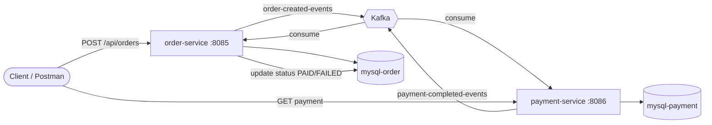

# Kafka Order Payment System

Event-driven microservices demonstrating **order creation**, **Kafka messaging**, and **asynchronous payment processing** with separate MySQL databases per service.

> **Ports:** Order **8085**, Payment **8086**, Kafka **9093**, ZK **2182** — see [MASTER_PORTS.md](../MASTER_PORTS.md).

## Architecture



## Tech Stack

| Component        | Version / Tool        |
|-----------------|------------------------|
| Java            | 17                     |
| Spring Boot     | 3.2.5                  |
| Apache Kafka    | 7.5.3 (Confluent)      |
| MySQL           | 8.0                    |
| Build           | Maven                  |
| Containers      | Docker Compose         |

## Project Structure

```
kafka-order-payment-system/
├── order-service/          # REST API + Kafka producer/consumer
├── payment-service/        # Kafka consumer + payment simulation
├── frontend/               # Responsive HTML/CSS/JS dashboard + Nginx proxy
├── docker-compose.yml      # Full stack (Zookeeper, Kafka, MySQL, services)
├── postman/                # Postman collection
├── .env.example
└── README.md
```

## Kafka Event Flow

1. **Order created** – Client calls `POST /api/orders` on **order-service**.
2. **Persist order** – Order saved in `order_db` with status `PENDING`.
3. **Publish** – `ORDER_CREATED` event sent to topic `order-created-events`.
4. **Payment processing** – **payment-service** consumes the event, simulates processing (~1.5s), saves payment in `payment_db`.
5. **Payment result** – Payment service publishes `PAYMENT_COMPLETED` to `payment-completed-events`.
6. **Order update** – **order-service** consumes payment event and sets order status to `PAID` or `FAILED`.

## Kafka Topics

| Topic                     | Producer         | Consumer(s)      | Payload        |
|---------------------------|------------------|------------------|----------------|
| `order-created-events`    | order-service    | payment-service  | `OrderEvent`   |
| `payment-completed-events`| payment-service  | order-service    | `PaymentEvent` |

Messages use JSON serialization without type headers. Partition key is `orderId`.

## Quick Start (Docker Compose)

### Prerequisites

- Docker Desktop (or Docker Engine + Compose v2)
- Ports available: `2181`, `9092`, `3307`, `3308`, `8085`, `8086`

### Steps

```bash
cd kafka-order-payment-system
cp .env.example .env
docker compose up --build -d
```

Wait until all containers are healthy (first build may take several minutes).

### Frontend Demo

The project includes a responsive operations dashboard served by Nginx. Start the full stack with the commands above, then open **http://localhost:3000**. The dashboard reads live orders from the order service, lets you create an order, refreshes order statuses automatically, and shows the selected order's progress through the payment event flow. The frontend proxies API requests to both services, so no browser CORS setup is needed.

To change the frontend port, set `FRONTEND_PORT` in `.env` (defaults to `3000`).

### Verify

```bash
# Create an order
curl -X POST http://localhost:8085/api/orders \
  -H "Content-Type: application/json" \
  -d "{\"customerName\":\"Alice\",\"productName\":\"Laptop\",\"quantity\":1,\"amount\":999.99}"

# Wait ~2 seconds for payment processing, then check order status (should be PAID)
curl http://localhost:8085/api/orders/1

# Check payment record
curl http://localhost:8086/api/payments/order/1
```

Import `postman/Kafka-Order-Payment.postman_collection.json` for ready-made requests.

## API Documentation

### Order Service (port 8085)

| Method | Endpoint                  | Description              |
|--------|---------------------------|--------------------------|
| POST   | `/api/orders`             | Create order + publish event |
| GET    | `/api/orders`             | List all orders          |
| GET    | `/api/orders/{id}`        | Get order by ID          |
| PUT    | `/api/orders/{id}/status` | Update status (`?status=PAID`) |

**Create order body:**

```json
{
  "customerName": "Alice",
  "productName": "Laptop",
  "quantity": 1,
  "amount": 999.99
}
```

**Order statuses:** `PENDING`, `PAYMENT_PROCESSING`, `PAID`, `FAILED`

### Payment Service (port 8086)

| Method | Endpoint                      | Description           |
|--------|-------------------------------|-----------------------|
| GET    | `/api/payments`               | List all payments     |
| GET    | `/api/payments/order/{orderId}` | Payment for an order |

**Payment statuses:** `PROCESSING`, `SUCCESS`, `FAILED`

Payments with `amount <= 0` are simulated as **FAILED**.

## Local Development (without Docker apps)

1. Start infrastructure only:

```bash
docker compose up -d zookeeper kafka mysql-order mysql-payment
```

2. Run services (separate terminals):

```bash
cd order-service
mvn spring-boot:run

cd payment-service
mvn spring-boot:run
```

Set environment variables for local MySQL ports (`3307` / `3308`) and `KAFKA_BOOTSTRAP_SERVERS=localhost:9092`.

## Troubleshooting

| Issue | Solution |
|-------|----------|
| `Connection refused` to Kafka | Ensure Kafka container is healthy; use `kafka:29092` inside Docker, `localhost:9092` on host |
| Order stays `PENDING` | Check payment-service logs; verify consumer group `payment-service-group` is running |
| `Communications link failure` (MySQL) | Wait for MySQL healthcheck; confirm credentials match `.env` |
| Duplicate payment for same order | Idempotent check skips re-processing; safe on Kafka redelivery |
| Build fails in Docker | Ensure Maven can resolve dependencies (network during `docker compose build`) |
| Port already in use | Change ports in `.env` (`ORDER_SERVICE_PORT`, etc.) |

View logs:

```bash
docker compose logs -f order-service payment-service kafka
```

Stop stack:

```bash
docker compose down
# Remove volumes: docker compose down -v
```

## License

MIT – use freely for learning and demos.
